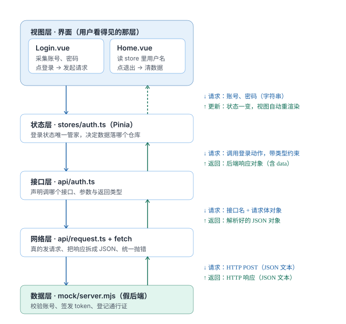
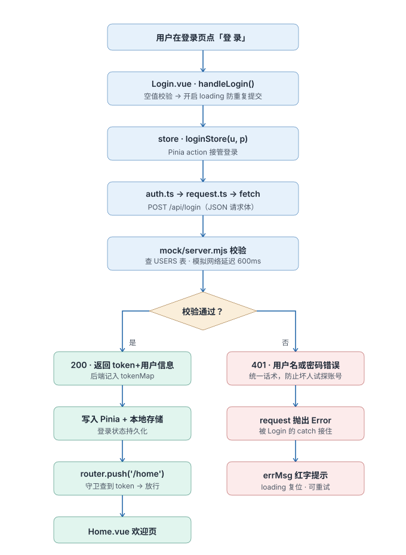

# Vue3 登录鉴权项目

> 基于 Vue3 + Pinia + Vue Router 的登录鉴权实现

## ✨ 功能
- [x] 登录表单与校验
- [x] loading 状态防重复提交
- [x] Pinia 全局状态管理
- [x] token localStorage 持久化（刷新不丢登录态）
- [x] 路由守卫拦截未登录访问
- [x] Mock 接口层（前后端分离开发）

## 🛠 技术栈 
Vue3 / Vite / Pinia / Vue Router


## 🏗 架构设计



## 🔄 登录执行流程


## 难点说明
### 从简易组件根据业务分层各项组件实现
分层的本质不是技术，是“让每一层只操心一件事”

| 层 | 文件 | 唯一职责 | 单独成层的好处（"变化"来时只改一处）|
|---|---|---|---|
| ① 视图层 | `components/*.vue` | 界面长什么样、用户点了什么、loading / errMsg / 跳转 | 改样式、改交互提示，完全不影响数据与请求逻辑 ★ |
| ② 状态层 | `stores/auth.ts` | 登录数据住哪、谁能改、怎么持久化 | 换 localStorage 为 Cookie、加权限字段，视图与接口层无感 ★ |
| ③ 业务接口层 | `api/auth.ts` | 每个接口一个函数，写清参数与返回类型 | 新增 `/api/me`、改接口路径，只动这一个文件 ★ |
| ④ 通用请求层 | `api/request.ts` | 拼地址、解析 JSON、失败抛错 | 换服务器地址（改 `BASE_URL`），全局一次生效 ★ |
| ⑤ 数据源 | `mock/server.mjs` | 数据从哪来 | 以后接真后端，只换这一个进程，前端代码一行不改 ★ |

### 为什么必须"这么分"
复用性：一个函数/数据，多个组件都能用
独立性:request.ts 不知道有 token 这回事，store 不知道页面长什么样，组件里没有一处 fetch

## 启动方式
在项目目录下
```bash
node mock/server.mjs
cnpm run dev
```